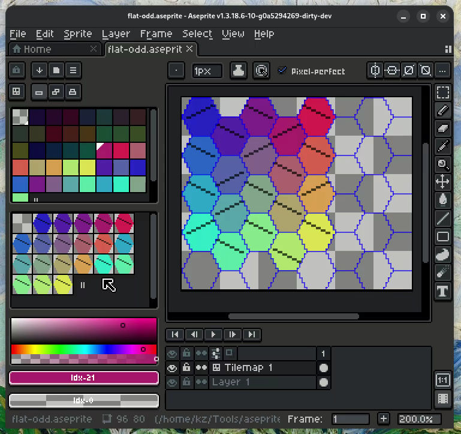
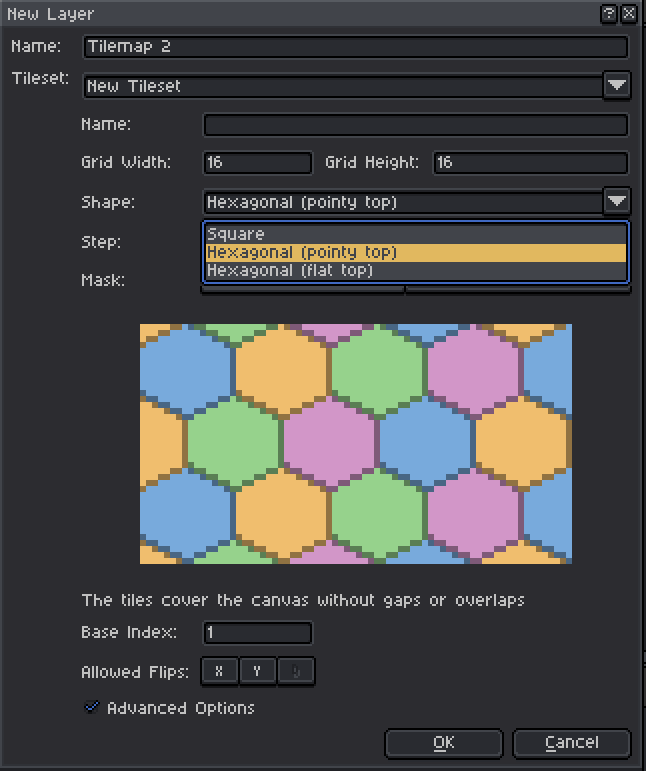

# About 

This is a tweaked version of Aseprite v1.3.18.6 (based on upstream `e5ed241eb`) that support hexagonal tilemap.

This fork contains AI generated content.

## License

Aseprite's EULA allows compiling the source code for personal use, but not redistributing binaries.

## Features

- Hexagonal pointy top tilemap support
- Hexagonal flat top tilemap support
- Custom tiles mask






# Hexagonal tilemaps: user guide

This custom build of Aseprite supports hexagonal tilemaps. A hexagonal tilemap is a regular tilemap layer whose tileset uses a hexagonal grid. Everything that works with square tilemaps works with hexagonal ones.

## Creating a hexagonal tilemap

- **New layer:** *Layer > New > New Tilemap Layer*. In the dialog, choose a **Shape**:
  - *Hexagonal (pointy top)*: rows of hexagons, every other row shifted half a tile.
  - *Hexagonal (flat top)*: columns of hexagons, every other column shifted half a tile.
- **Existing layer:** *Layer > Convert To > Tilemap*, with the same options. The layer keeps its look, cut into hexagonal tiles.
- **Existing tilemap:** open the layer properties, then the tileset button, and change the shape. Pixels outside the new hexagon shape become transparent (*Undo* restores them).

The hexagonal options:

| Option | Meaning |
|---|---|
| **Grid Width / Height** | Size of the tile images (the bounding box of the hexagon). |
| **Step** | Distance between rows (pointy top) or columns (flat top). The default gives regular-looking hexagons. It must be between half the tile size + 1 and the tile size. |
| **Parity** | Which rows (or columns) are shifted half a tile: odd or even. |
| **Mask** | *Auto* generates a hexagon that tiles the plane without gaps or overlaps. *Custom* lets you draw your own tile shape, pixel by pixel, or use the current selection (*Use Selection*). A custom mask must tile the plane: the preview shows where it leaves gaps or overlaps, and OK is disabled until the mask is valid (*Reset* restores the automatic one). |

A width (pointy top) or height (flat top) that is odd can't make a symmetric hexagon, so the automatic mask is a staggered brick.

Pixels outside the mask of a tile are always transparent. In *Advanced Options*, the X/Y flips used to match tiles are available only when the mask is symmetric on that axis. Diagonal flips and rotations don't exist for hexagonal tiles.

## Drawing

Everything works as with square tilemaps. The difference is that a pixel belongs to exactly one hexagon: near a corner of a tile's bounding box, the pixel belongs to a neighbor.

**Tiles mode** (the Tiles button in the color bar):
- The pencil, eraser, lines and shapes place whole hexagons. The cursor shows the hexagon under the mouse.
- The paint bucket fills hexagons connected by their 6 edges.
- The eyedropper picks the tile of the hexagon under the mouse.
- *View > Show > Grid* draws the hexagon outlines, and *Tile Numbers* are centered in each hexagon.

**Pixels mode** (Auto, Manual, Stack) works exactly like on a regular layer:
- *Auto* and *Stack* create or reuse tiles as you draw.
- *Manual* edits the tiles themselves, so every copy of a tile changes.
- The paint bucket's *Stop at Grid* option stops at the edges of the hexagon.

## Selecting, moving and copying tiles

In tiles mode, selections are made of whole hexagons:
- The rectangular marquee selects the hexagons whose centers are inside the dragged rectangle (the corners snap to hexagon centers).
- The lasso and polygon select the hexagons whose centers are inside the shape.
- The magic wand selects the connected hexagons with the same tile.
- A double-click, or the *Select Tile* command, selects the hexagon under the mouse.

**Moving selected tiles:**
- Drag them, or use the arrow keys. The tiles move from hexagon to hexagon. Moving an odd number of rows (or columns) shifts them half a tile, so they stay on the grid.
- Ctrl+drag copies them.
- Hexagonal tiles can't be scaled, rotated or skewed, so there are no handles around the selection.

**Flipping and rotating a selection:**
- *Edit > Flip Horizontal/Vertical* mirrors the positions of the selected tiles, if the tile shape is symmetric on that axis. As with square tiles, the tile images themselves are not flipped.
- *Edit > Rotate 180°* flips both ways. Rotating 90° isn't possible and shows a message.

**Copy and paste:** copied tiles paste at the same place, keeping the shift of their rows. Pasting into a regular layer pastes the pixels, with the exact hexagon shapes.

**Moving a tilemap cel** with the Move tool is free (each cel can start anywhere). With *Snap to Grid*, it moves by two rows (or columns) at a time, so its hexagons stay aligned with the other frames.

## Sprite operations

- **Canvas Size, Crop and Trim** keep the hexagons aligned.
- **Flip Canvas** mirrors the tile positions around the grid axis closest to the canvas center.
- **Rotate Canvas 180°** works. **Rotate Canvas 90°** leaves hexagonal tilemaps as they are, because a pointy-top grid would become a flat-top one.
- **Sprite Size** scales the tiles and the step. A custom mask is replaced by the automatic mask of the new size.

## Files

Hexagonal tilemaps are saved in `.aseprite` files. The official version of Aseprite opens these files with square tiles (the hexagonal settings are kept in the tileset properties), and keeps the settings when it saves the file.

## Lua API

Scripts can check `app.apiVersion >= 42`, or `GridShape ~= nil`, before using this API.

### Constants

| Constant | Values |
|---|---|
| `GridShape` | `SQUARE`, `HEX_POINTY_TOP` (odd or even rows are shifted), `HEX_FLAT_TOP` (odd or even columns are shifted) |
| `GridParity` | `ODD` (odd rows/columns are shifted half a tile), `EVEN` |

### Creating a grid

```lua
local g = Grid{ tileSize=Size(16, 16), shape=GridShape.HEX_POINTY_TOP }

local g2 = Grid{
  tileSize=Size(12, 18),
  shape=GridShape.HEX_FLAT_TOP,
  parity=GridParity.EVEN,
  step=10,       -- distance between columns (flat top) or rows (pointy top)
  origin=Point(0, 0),
  mask=rows,     -- optional custom mask (see below)
}
```

- The table fields are all optional except `tileSize`:
  - `shape` defaults to `GridShape.SQUARE`.
  - `parity` defaults to `GridParity.ODD`.
  - `step` defaults to the height minus a quarter of the height (pointy top), or the width minus a quarter of the width (flat top). It must be between `height/2 + 1` and `height` (pointy top), or `width/2 + 1` and `width` (flat top). Other values raise an error.
- `mask` is a table with one string per row of the tile, where `#` is a pixel of the tile and `.` isn't. It can also be an image of the tile size (pixels with a value different from 0). The default is the automatic hexagon. A custom mask must tile the plane without gaps or overlaps. If it doesn't, the constructor raises an error with the first wrong pixel, for example `the mask doesn't tessellate: the pixel 0,0 is covered by 2 tiles`.
- A width (pointy top) or height (flat top) that is odd can't make a hexagon, so the automatic mask is a staggered brick.
- `Grid(rectangle)` and `Grid(grid)` work as before.

### Grid properties and methods

| Member | Description |
|---|---|
| `grid.tileSize` | `Size` of the tiles. |
| `grid.origin` | `Point`, the position of the tile 0,0 in the canvas. This property can be changed on a `Grid` object. |
| `grid.shape` | A `GridShape` value. |
| `grid.parity` | A `GridParity` value. |
| `grid.step` | Distance between rows or columns, 0 for square grids. |
| `grid.mask` | Table of strings (`#`/`.`) with the pixels of the tiles, or `nil` for square grids. |
| `grid.validFlips` | Tile flags (`app.pixelColor.TILE_XFLIP`, `TILE_YFLIP`, `TILE_DFLIP`) that can be used with this grid. Hexagonal grids never allow `TILE_DFLIP`, and allow X/Y flips only if the mask is symmetric on that axis. |
| `grid:canvasToTile(point)` | The tile (`Point`) that owns the given canvas pixel. In a hexagonal grid, a pixel in a corner of a tile's bounding box belongs to a neighbor tile. |
| `grid:tileToCanvas(tile)` | The canvas position of the bounding box of the given tile. |
| `grid:neighbors(tile)` | Table with the 6 tiles adjacent to the given tile, or 4 in a square grid. |

In a hexagonal grid, tile indexes are "offset coordinates": the tilemap is still a 2D array, and every other row (pointy top) or column (flat top) is shifted half a tile.

### Tilesets and tilemap layers

```lua
local spr = Sprite(128, 128)
local ts = spr:newTileset(Grid{ tileSize=Size(16, 16), shape=GridShape.HEX_POINTY_TOP }, 1)
-- or: spr:newTileset({ tileSize=Size(16, 16), shape=GridShape.HEX_POINTY_TOP }, 1)

app.command.NewLayer{ tilemap=true }
app.layer.tileset = ts

-- Change the grid of an existing tileset (undoable). The tile size
-- can't be changed, and the origin is always 0,0.
ts.grid = Grid{ tileSize=Size(16, 16), shape=GridShape.HEX_FLAT_TOP }
```

- Pixels outside the mask of a hexagonal tile are always transparent: they are cleared when a tile image is set or drawn.
- The grid of a tileset has its origin at 0,0. The tiles of a tilemap cel start at the cel position. To convert between canvas pixels and tiles of a cel, use the tileset grid with the cel position as the origin:

  ```lua
  local g = cel.layer.tileset.grid
  g.origin = cel.position
  local tile = g:canvasToTile(Point(40, 30))  -- index in cel.image
  local t = cel.image:getPixel(tile.x, tile.y)
  ```

- The first row (pointy top) or column (flat top) of a tilemap image is shifted like the row or column 0 of the grid: not shifted with `GridParity.ODD`, shifted with `GridParity.EVEN`. When Aseprite grows a hexagonal tilemap up or left, it adds two rows (or columns) at a time to keep this rule.

## JSON data of sprite sheets

When at least one exported sprite has a hexagonal tileset, the JSON data (*File > Export Sprite Sheet*, *Export Tileset*, or `--data` from the CLI) has a `meta.tilesets` array with all the tilesets of the exported sprites:

```json
"tilesets": [
 { "index": 0, "name": "Hexes", "tileSize": { "w": 16, "h": 16 }, "shape": "hexPointyTop",
   "parity": "odd", "step": 12,
   "mask": [".......##.......", ".....######.....", "..."],
   "layers": ["Tilemap 1"] }
]
```

- `shape` is `"square"`, `"hexPointyTop"` or `"hexFlatTop"`. `parity`, `step` and `mask` are included only for hexagonal tilesets.
- `layers` lists the tilemap layers that use the tileset.
- The tileset user data (color, text, properties) is added like in other `meta` items.
- Without hexagonal tilesets there is no `meta.tilesets`, so the JSON is the same as in the official version.


# Aseprite

[](https://github.com/aseprite/aseprite/actions/workflows/build.yml)
[](https://hosted.weblate.org/engage/aseprite/)
[](https://community.aseprite.org/)
[](https://discord.gg/Yb2CeX8)

## Introduction

**Aseprite** is a program to create animated sprites. Its main features are:

* Sprites are composed of [layers &amp; frames](https://www.aseprite.org/docs/timeline/) as separated concepts.
* Support for [color profiles](https://www.aseprite.org/docs/color-profile/) and different [color modes](https://www.aseprite.org/docs/color-mode/): RGBA, Indexed (palettes up to 256 colors), Grayscale.
* [Animation facilities](https://www.aseprite.org/docs/animation/), with real-time [preview](https://www.aseprite.org/docs/preview-window/) and [onion skinning](https://www.aseprite.org/docs/onion-skinning/).
* [Export/import](https://www.aseprite.org/docs/exporting/) animations to/from [sprite sheets](https://www.aseprite.org/docs/sprite-sheet/), GIF files, or sequence of PNG files (and FLC, FLI, JPG, BMP, PCX, TGA).
* [Multiple editors](https://www.aseprite.org/docs/workspace/#drag-and-drop-tabs) support.
* [Layer groups](https://imgur.com/x3OKkGj) for organizing your work, and [reference layers](https://twitter.com/aseprite/status/806889204601016325) for rotoscoping.
* Pixel-art specific tools like [Pixel Perfect freehand mode](https://imgur.com/0fdlNau), [Shading ink](https://www.aseprite.org/docs/shading/), [Custom Brushes](https://twitter.com/aseprite/status/1196883990080344067), [Outlines](https://twitter.com/aseprite/status/1126548469865431041), [Wide Pixels](https://imgur.com/1yZKUcs), etc.
* Other special drawing tools like [Pressure sensitivity](https://twitter.com/aseprite/status/1253770784708886533), [Symmetry Tool](https://twitter.com/aseprite/status/659709226747625472), [Stroke and Fill](https://imgur.com/7JZQ81o) selection, [Gradients](https://twitter.com/aseprite/status/1126549217856622597).
* [Tiled mode](https://youtu.be/G_JeWBaxQIg) useful to draw patterns and textures.
* [Transform multiple frames/layers](https://twitter.com/aseprite/status/1170007034651172866) at the same time.
* [Lua scripting capabilities](https://www.aseprite.org/docs/scripting/).
* [CLI - Command Line Interface](https://www.aseprite.org/docs/cli/) to automatize tasks.
* [Quick Reference / Cheat Sheet](https://www.aseprite.org/quickref/) keyboard shortcuts ([customizable keys](https://imgur.com/rvAUxyF) and [mouse wheel](https://imgur.com/oNqFqVb)).
* [Reopen closed files](https://twitter.com/aseprite/status/1202641475256881153) and [recover data](https://www.aseprite.org/docs/data-recovery/) in case of crash.
* Undo/Redo for every operation and support for [non-linear undo](https://imgur.com/9I42fZK).
* [More features &amp; tips](https://twitter.com/aseprite/status/1124442198651678720)

## Issues

There is a list of
[Known Issues](https://github.com/aseprite/aseprite/issues) (things
to be fixed or that aren't yet implemented).

If you found a bug or have a new idea/feature for the program,
[you can report them](https://github.com/aseprite/aseprite/issues/new).

## Support

You can ask for help in:

* [Aseprite Community](https://community.aseprite.org/)
* [Aseprite Discord Server](https://discord.gg/Yb2CeX8)
* Official support: [support@aseprite.org](mailto:support@aseprite.org)
* Social networks and community-driven places:
  [Twitter](https://twitter.com/aseprite/),
  [Facebook](https://facebook.com/aseprite/),
  [YouTube](https://www.youtube.com/user/aseprite),
  [Instagram](https://www.instagram.com/aseprite/).

## Credits

Aseprite was originally created by [David Capello](https://davidcapello.com/)
and is now being developed and maintained by [Igara Studio](https://igara.com/)
and contributors.

Check the [AUTHORS](AUTHORS.md) file for details about the active team
of developers working on Aseprite.

## License

This program is distributed under three different licenses:

1. Source code and official releases/binaries are distributed under
   our [End-User License Agreement for Aseprite (EULA)](EULA.txt). Please check
   that there are [modules/libraries in the source code](src/README.md) that
   are distributed under the MIT license
   (e.g. [laf](https://github.com/aseprite/laf),
   [clip](https://github.com/aseprite/clip),
   [undo](https://github.com/aseprite/undo),
   [observable](https://github.com/aseprite/observable),
   [ui](src/ui), etc.).
2. You can request a special
   [educational license](https://www.aseprite.org/faq/#is-there-an-educational-license)
   in case you are a teacher in an educational institution and want to
   use Aseprite in your classroom (in-situ).
3. Steam releases are distributed under the terms of the
   [Steam Subscriber Agreement](http://store.steampowered.com/subscriber_agreement/).

You can get more information about Aseprite license in the
[FAQ](https://www.aseprite.org/faq/#licensing-&-commercial).
